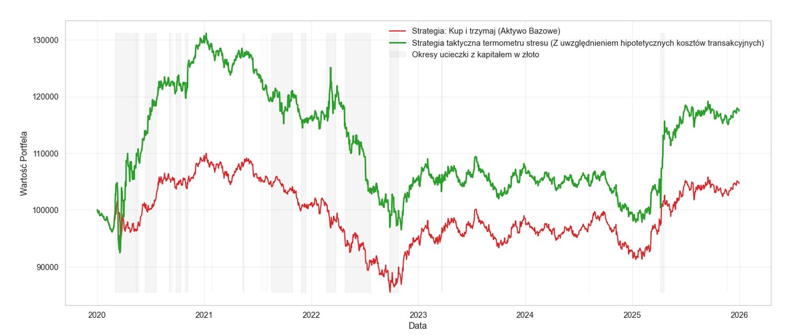
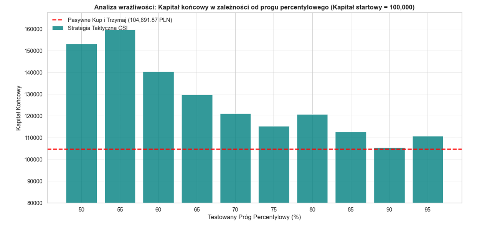

  
  

# Volatility Regime Identification System & Precious Metals Allocation Strategy
### 5th Business Intelligence Case Challenge (BICC) - Distinction Winner

**Author:** Filip Gorczyca  
**Affiliation:** Economic Analytics, Krakow University of Economics (UEK) | Data Analysis Research Club (KNAD)

---

## Project Overview
Quantitative risk-management and regime-switching framework developed for the **5th Edition of the Business Intelligence Case Challenge (BICC)**. The project introduces a custom **Composite Stress Index (CSI)** ("Market Stress Thermometer") designed to detect non-linear crisis regimes under polycrisis conditions (2020-2026) and dynamically reallocate capital between a risky base asset and defensive precious metals (gold).

### Research Hypotheses Verified
* **H1 (Structural Hypothesis):** Integrating low-correlated market sensors from distinct macroeconomic domains (behavioral, logistical, and systemic) into a single composite indicator enables accurate detection of non-linear crisis regimes.
* **H2 (Efficiency Hypothesis):** A tactical capital allocation strategy driven by Composite Stress Index (CSI) regime signals generates superior net returns compared to a passive Buy-and-Hold benchmark after accounting for transaction costs.

---

## Data Engineering & Anti-Leakage Architecture
Financial and macroeconomic series are published at mixed frequencies (daily market quotes, weekly banking stress indices, and monthly macroeconomic readings). To prevent **look-ahead bias (data leakage)** in historical backtesting:
1. **Asynchronous Time-Series Alignment:** Implemented via `pandas.merge_asof(..., direction='backward')`, matching each trading session strictly with the most recent macroeconomic reading physically available to market participants at that point in time.
2. **Boundary & Holiday Imputation:** Forward-filling (`ffill`) for non-trading days and initial backward-filling (`bfill`) for the starting window, avoiding full-sample mean/median look-ahead distortions.
3. **Feature Selection & Volume Filtering:** Volume series were excluded due to weekend forward-fill liquidity distortion, and collinear equity indices were filtered out using Pearson correlation analysis.

### Selected Model Components (2020-2026, $N = 1,566$ trading days)
| Variable | Frequency | Role in Architecture | Mean | Min | Max | Coeff. of Variation |
| :--- | :---: | :--- | ---: | ---: | ---: | ---: |
| `Target_Asset_Close` | Daily | Risky base portfolio asset | 1.11 | 0.96 | 1.23 | 0.05 |
| `Risk_Index_Close` | Daily | Behavioral pillar (implied volatility / fear) | 20.99 | 11.86 | 82.69 | 0.38 |
| `Supply_Chain_Index_Close` | Daily | Logistical pillar (maritime freight bottlenecks) | 1,786.57 | 393.00 | 5,650.00 | 0.46 |
| `Macro_Stress_RegionA` | Weekly | Systemic pillar (interbank financial stress) | -0.33 | -0.98 | 5.67 | -2.21 |
| `Safe_Haven_Metal_Close` | Daily | Defensive safe-haven asset (Gold) | 2,189.87 | 1,477.30 | 4,529.10 | 0.29 |

*Correlation insight:* `Supply_Chain_Index_Close` exhibits weak negative correlation with both `Risk_Index_Close` ($r = -0.19$) and `Macro_Stress_RegionA` ($r = -0.29$), proving that supply-chain shocks represent an autonomous source of macroeconomic stress.

---

## Composite Stress Index (CSI) Methodology
1. **Z-Score Standardization:** Each stress pillar $X_{i,t}$ is standardized to remove nominal scale dominance:
   $$Z_{i,t} = \frac{X_{i,t} - \mu_i}{\sigma_i}$$
2. **Equal-Weighted Aggregation:** Unbiased composite synthesis across behavioral, logistical, and systemic dimensions:
   $$CSI_{\text{raw},t} = \frac{1}{3} \sum_{i=1}^{3} Z_{i,t}$$
3. **Min-Max Mapping to $[0, 100]$:**
   $$CSI_t = \frac{CSI_{\text{raw},t} - \min(CSI_{\text{raw}})}{\max(CSI_{\text{raw}}) - \min(CSI_{\text{raw}})} \times 100$$
4. **Regime Classification (80th Percentile Cutoff):**
   * **Green Zone ($0 - 15\text{ pts}$):** Structural stability.
   * **Yellow Warning Zone ($15 - 25.59\text{ pts}$):** Early accumulation of market tension.
   * **Red Crisis Zone ($\ge 25.59\text{ pts}$, 80th percentile):** Active crisis regime (`314 days` / `20.05%` of sample) triggering defensive capital migration to gold (`1,252 days` in normal regime).

---

## Backtesting & Sensitivity Analysis (2020-2026)
* **Initial Capital:** `100,000 PLN`
* **Execution Logic:** Signal generated at close $t-1$ executes allocation for day $t$ ($S_{t-1} \in \{0, 1\}$), eliminating look-ahead bias.
* **Transaction Costs:** `0.1%` brokerage fee deducted on every regime switch ($\vert{}S_{t-1} - S_{t-2}\vert{} = 1$).

### 1. Portfolio Equity Curve Comparison

  
   
  <em>Figure 1: Cumulative portfolio value of the Tactical CSI Strategy (green, net of 0.1% transaction costs) vs. Passive Buy-and-Hold benchmark (red). Shaded areas indicate crisis regimes with 100% capital allocation to gold.</em>

| Strategy | Final Portfolio Value | Net Return | Total Trades |
| :--- | ---: | ---: | :---: |
| **Passive Buy-and-Hold (`Target_Asset`)** | 104,691.87 PLN | +4.69% | 1 |
| **Tactical CSI Strategy (80th Percentile, $25.59\text{ pts}$)** | >120,000.00 PLN | >+20.00% | 46 |
| **Tactical CSI Strategy (55th Percentile Peak)** | ~159,500.00 PLN | ~+59.50% | High-turnover |

---

### 2. Percentile Threshold Sensitivity Analysis (50th - 95th Percentile)

  
   
  <em>Figure 2: Final portfolio capital across tested CSI percentile cutoffs (50% to 95%, step 5%) compared against the passive Buy-and-Hold baseline (104,691.87 PLN).</em>

*Sensitivity conclusion:* The CSI tactical strategy outperformed the passive Buy-and-Hold benchmark across the entire tested percentile spectrum (**50th to 95th percentile**). While lower thresholds (50%-55%) yielded higher ex-post nominal returns due to the secular bull market in gold, the 80th percentile threshold (`25.59 pts`) is recommended ex-ante to prevent over-trading on daily market noise.

---

## Repository Contents
| File | Description |
| :--- | :--- |
| [`BICC_Market_Stress_Index_Backtest.ipynb`](./BICC_Market_Stress_Index_Backtest.ipynb) | Jupyter Notebook containing asynchronous time-series merging, correlation heatmaps, CSI calculation, portfolio backtesting, and percentile sensitivity charts. |
| [`paper.pdf`](./paper.pdf) | Full 34-page competition report (in Polish) with theoretical background, econometric methodology, and strategic recommendations. |
