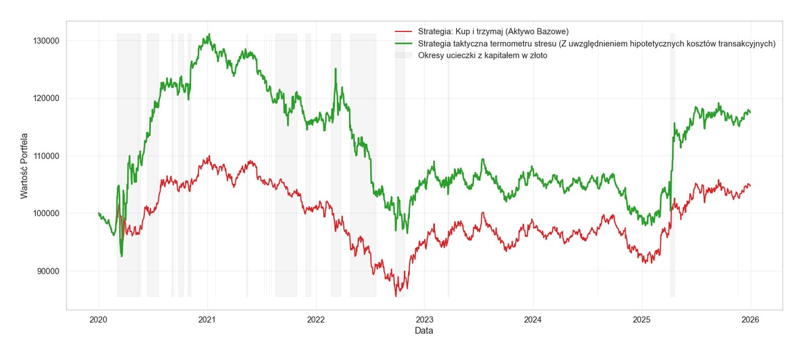
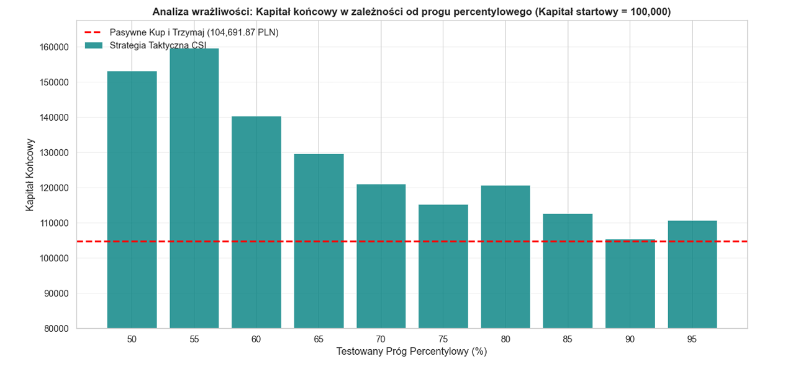

  
  

# System identyfikacji reżimów zmienności w warunkach polikryzysu
### V edycja konkursu Business Intelligence Case Challenge (BICC) - Wyróżnienie

**Autor:** Filip Gorczyca  
**Afiliacja:** Analityka Gospodarcza, Uniwersytet Ekonomiczny w Krakowie (UEK) | Koło Naukowe Analizy Danych (KNAD)

---

## Opis projektu
Ilościowy system wczesnego ostrzegania i dynamicznej alokacji kapitału opracowany w ramach **V edycji ogólnopolskiego konkursu Business Intelligence Case Challenge (BICC)**. Projekt obejmuje konstrukcję autorskiego wskaźnika kompozytowego **Termometru Stresu Rynkowego (CSI)**, który identyfikuje nieliniowe reżimy kryzysowe w warunkach polikryzysu (lata 2020-2026) i automatycznie zarządza ekspozycją portfela pomiędzy aktywem bazowym a rynkiem metali szlachetnych (złotem).

### Zweryfikowane hipotezy badawze
* **H1 (Hipoteza strukturalna):** Połączenie sensorów rynkowych z odmiennych obszarów makroekonomicznych (behawioralnego, logistycznego i systemowego) w jeden wskaźnik kompozytowy pozwala na skuteczną identyfikację nieliniowych reżimów kryzysowych.
* **H2 (Hipoteza efektywnościowa):** Strategia taktycznej alokacji kapitału sterowana sygnałami Termometru Stresu Rynkowego (CSI) pozwala na wygenerowanie wyższej stopy zwrotu netto w stosunku do pasywnej strategii „Kup i Trzymaj” po uwzględnieniu kosztów transakcyjnych.

---

## Inżynieria danych i eliminacja błędu Look-Ahead Bias (Data Leakage)
Dane wejściowe obejmowały trzy zbiory publikowane z różną częstotliwością (notowania dzienne, tygodniowe wskaźniki stresu bankowego oraz miesięczne odczyty makroekonomiczne). Aby wykluczyć **retrospektywny wyciek informacji (data leakage)** podczas symulacji historycznej:
1. **Asynchroniczne scalanie szeregów czasowych:** Zastosowano funkcję `pandas.merge_asof(..., direction='backward')`, przypisując do każdego dnia sesyjnego wyłącznie ostatni opublikowany i fizycznie znany uczestnikom rynku odczyt makroekonomiczny.
2. **Obsługa braków danych:** Zastosowano interpolację w przód (`ffill`) dla dni wolnych od sesji oraz interpolację wsteczną (`bfill`) dla pojedynczych rekordów startowych, unikając błędnego uśredniania z przyszłych okresów.
3. **Selekcja zmiennych i redukcja współliniowości:** Odrzucono sztucznie powielane przez weekendy dane wolumenowe (`Volume`) oraz silnie skorelowane indeksy akcyjne na podstawie analizy macierzy korelacji liniowej Pearsona.

### Wybrane komponenty modelu (2020-2026, $N = 1\,566$ dni sesyjnych)
| Zmienna | Częstotliwość | Rola w architekturze systemu | Średnia | Min | Max | Wsp. zmienności |
| :--- | :---: | :--- | ---: | ---: | ---: | ---: |
| `Target_Asset_Close` | Dzienna | Główne aktywo bazowe (ryzykowne) | 1,11 | 0,96 | 1,23 | 0,05 |
| `Risk_Index_Close` | Dzienna | Wymiar behawioralny (zmienność implikowana / strach) | 20,99 | 11,86 | 82,69 | 0,38 |
| `Supply_Chain_Index_Close` | Dzienna | Wymiar logistyczny (koszty frachtu i zatory podażowe) | 1 786,57 | 393,00 | 5 650,00 | 0,46 |
| `Macro_Stress_RegionA` | Tygodniowa | Wymiar systemowy (stres płynnościowy w sektorze bankowym) | -0,33 | -0,98 | 5,67 | -2,21 |
| `Safe_Haven_Metal_Close` | Dzienna | Aktywo defensywne / bezpieczna przystań (złoto) | 2 189,87 | 1 477,30 | 4 529,10 | 0,29 |

*Wniosek z analizy korelacji:* Wymiar logistyczny (`Supply_Chain_Index_Close`) wykazuje słabą, ujemną korelację z wymiarem behawioralnym ($r = -0,19$) oraz systemowym ($r = -0,29$), co dowodzi, że zatory w handlu morskim stanowią autonomiczne źródło szoku makroekonomicznego.

---

## Metodologia budowy Termometru Stresu Rynkowego (CSI)
1. **Standaryzacja statystyczna Z-Score:** Sprowadzenie komponentów o różnych rzędach wielkości do wspólnej płaszczyzny bezwymiarowej:
   $$Z_{i,t} = \frac{X_{i,t} - \mu_i}{\sigma_i}$$
2. **Agregacja równoważona:** Obliczenie średniej arytmetycznej z trzech wystandaryzowanych filarów ryzyka:
   $$CSI_{\text{raw},t} = \frac{1}{3} \sum_{i=1}^{3} Z_{i,t}$$
3. **Transformacja Min-Max do przedziału $[0, 100]$:**
   $$CSI_t = \frac{CSI_{\text{raw},t} - \min(CSI_{\text{raw}})}{\max(CSI_{\text{raw}}) - \min(CSI_{\text{raw}})} \times 100$$
4. **Wyznaczenie progów sygnalizacyjnych (kryterium 80. percentyla):**
   * **Strefa Stabilności ($0 - 15\text{ pkt}$):** Strukturalny spokój rynkowy.
   * **Strefa Ostrzegawcza ($15 - 25,59\text{ pkt}$):** Bufor wczesnego ostrzegania o narastających napięciach.
   * **Strefa Kryzysowa ($\ge 25,59\text{ pkt}$, 80. percentyl):** Reżim głębokiego stresu (`314 dni` / `20,05%` próby) uruchamiający automatyczny transfer 100% kapitału do złota (`1 252 dni` w reżimie normalnym).

---

## Symulacja historyczna (Backtest) i analiza wrażliwości (2020-2026)
* **Kapitał początkowy:** `100 000 PLN`
* **Mechanika sygnału:** Alokacja w dniu $t$ zależy od stanu sygnału z zamknięcia dnia poprzedniego $S_{t-1} \in \{0, 1\}$ (brak data leakage).
* **Koszty transakcyjne:** Prowizja maklerska `0,1%` naliczana od wartości obrotu przy każdej zmianie reżimu ($|S_{t-1} - S_{t-2}| = 1$).

### 1. Porównanie krzywych kapitału analizowanych strategii

  
   
  <em>Wykres 1: Skumulowana wartość portfela strategii taktycznej CSI (zielona linia, po uwzględnieniu kosztów transakcyjnych 0,1%) na tle pasywnej strategii Kup i Trzymaj (czerwona linia). Szare obszary oznaczają okresy reżimu kryzysowego i alokacji kapitału w złoto.</em>

| Strategia inwestycyjna | Końcowa wartość portfela | Stopa zwrotu netto | Liczba transakcji |
| :--- | ---: | ---: | :---: |
| **Pasywna strategia „Kup i Trzymaj” (`Target_Asset`)** | 104 691,87 PLN | +4,69% | 1 |
| **Strategia taktyczna CSI (Próg 80. percentyla, $25,59\text{ pkt}$)** | >120 000,00 PLN | >+20,00% | 46 |
| **Strategia taktyczna CSI (Maksimum dla 55. percentyla)** | ~159 500,00 PLN | ~+59,50% | Wysoka rotacja |

---

### 2. Analiza wrażliwości względem progu percentylowego (percentyle 50 - 95)

  
   
  <em>Wykres 2: Wartość kapitału końcowego dla testowanych progów odcięcia indeksu CSI (od 50. do 95. percentyla, z krokiem co 5%) na tle pasywnego benchmarku Kup i Trzymaj (104 691,87 PLN).</em>

*Wniosek z analizy wrażliwości:* Strategia taktyczna CSI wygenerowała dodatnią nadwyżkę finansową nad pasywnym benchmarkiem w całym badanym spektrum progów percentylowych (**od 50% do 95%**). Konserwatywny próg 80. percentyla (`25,59 pkt`) stanowi optymalny punkt równowagi ex-ante, chroniący portfel przed nadmierną liczbą transakcji wywołanych codziennym szumem informacyjnym.

---

## Zawartość repozytorium
| Plik | Opis |
| :--- | :--- |
| [`BICC_Market_Stress_Index_Backtest.ipynb`](./BICC_Market_Stress_Index_Backtest.ipynb) | Notatnik Jupyter zawierający kod w języku Python: scalanie szeregów czasowych `merge_asof`, analizę korelacji, kalkulację indeksu CSI, symulację portfelową oraz analizę wrażliwości. |
| [`paper.pdf`](./paper.pdf) | Pełny 34-stronicowy raport konkursowy zawierający wprowadzenie teoretyczne, opis metodologiczny, wykresy oraz weryfikację hipotez badawczych. |
